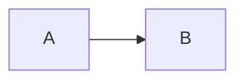

# markdown-render.nvim

A small Markdown preview split for Neovim 0.13+. It displays local images with
Neovim's `vim.ui.img` API and renders Mermaid fenced blocks through Mermaid CLI.

## Requirements

- Neovim 0.13+
- A Kitty graphics protocol terminal for image output
- Optional Mermaid CLI: `npm install -g @mermaid-js/mermaid-cli`

## Usage

The plugin creates `:MarkdownRender`. Run it from a Markdown buffer; run it
again to close the preview. The preview updates on save and while editing.

```lua
require("markdown-render").setup({
  split = "right",       -- "right" or "left"
  width = 80,
  image_width = 60,
  image_height = 20,
  mermaid_command = "mmdc",
})
```

Images use paths relative to the Markdown file:

```markdown

```

Mermaid uses a normal fenced block:

````markdown

````
